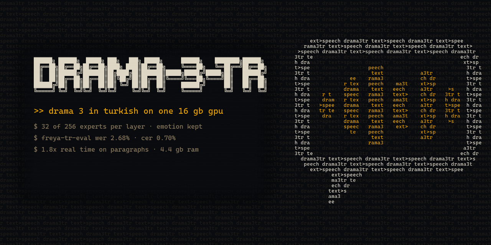

<p align="center"></p>

# drama-3-tr

Run Fish Audio Drama 3 in Turkish on a single 16 GB GPU, about 2.7 times faster than real time for short sentences and about 3.3 times for paragraphs, with its inline directions and emotion intact. The full model reads the prompt, a distilled 32-expert speaker generates the audio, and experts are streamed from the NVMe drive so the 41.5 GB checkpoint never has to sit in RAM.

Weights and full results are on Hugging Face at [kasparovabi/drama-3-tr-speaker](https://huggingface.co/kasparovabi/drama-3-tr-speaker). How it was built is written up on [dev.to](https://dev.to/kasparovabi/teaching-a-35b-voice-model-to-speak-turkish-on-one-16-gb-card-1ppl) and in Turkish on [Medium](https://medium.com/@snth9/35-milyar-parametrelik-ses-modelini-tek-16-gb-kartta-t%C3%BCrk%C3%A7e-konu%C5%9Fturmak-246e3f624260).

**Built with Fish Audio.** This project uses [Fish Audio Drama 3](https://huggingface.co/fishaudio/drama-3) and [fish-speech](https://github.com/fishaudio/fish-speech). It is not affiliated with or endorsed by Fish Audio.

## Results in one table

| | Value |
|---|---|
| Freya-TR-Eval WER and CER (495 sentences, Freya's protocol), guidance 4, disk mode with hot tier | 2.27% and 0.62% |
| Teacher-forced KL to unmodified Drama 3 (200 held-out utterances) | 0.066 |
| Short sentences on RTX 5070 Ti (Freya-TR-Eval, median 3.5 s), disk mode with hot tier, compiled | 2.7x real time (median) |
| Paragraphs of 16 to 20 s, same setup | 3.2 to 3.4x real time in five of six runs, 1.9x in one |
| Short sentences, disk mode without the hot tier, compiled | 1.2x real time (median) |
| VRAM | 14.0 GiB peak on short sentences, 15.0 GiB on paragraphs |
| System RAM | 25 GB with the 6,000-expert hot tier, 4.9 GB without it |

## Setup

Tested on Windows 11, Python 3.13, torch 2.14.1+cu132 and triton-windows 3.8.

```bash
git clone https://github.com/kasparovabi/drama-3-tr && cd drama-3-tr
git clone https://github.com/fishaudio/fish-speech && git -C fish-speech checkout 5415669
hf download fishaudio/drama-3 --local-dir models/drama-3
hf download kasparovabi/drama-3-tr-speaker speaker.safetensors config.json --local-dir .
hf download kasparovabi/drama-3-tr-speaker trace_experts.pt --local-dir results
pip install torch triton-windows safetensors tokenizers soundfile omegaconf hydra-core scipy psutil einops einx loguru descript-audio-codec
```

## Generate speech

`sentences.json` is a JSON list of strings. Put directions in square brackets, in Turkish.

```bash
TTS_COMPILE=max-autotune-no-cudagraphs python engine.py --speaker speaker.safetensors --graph --slots 300 --disk --hot 6000 \
  --ref my_voice.wav --ref_text my_voice.txt --sentences sentences.json --out out
```

`--hot 6000` keeps the 6,000 experts that Turkish prompts use most in pinned RAM (18.6 GB), chosen from `results/trace_experts.pt`. Leave it out on a machine with less than 32 GB of RAM, every expert then comes from the drive. `TTS_COMPILE` compiles the per-frame step with `torch.compile` before it is captured in a CUDA graph, which adds a few minutes to start-up. `TTS_FP8=1` also stores the dense attention, DeltaNet and audio decoder weights in block FP8. It is about 8% faster but raised Freya-TR-Eval WER to 3.29% in our run, so it is off by default.

`--cfg` sets the direction guidance strength (default 4, 0 turns it off) and `--seed` makes a run reproducible. `server.py` serves the same engine over HTTP (POST `/tts` with `{"text": ...}`, 16 kHz PCM back, or `"format": "wav"` for 44.1 kHz WAV). It reads `TTS_HOT`, `TTS_COMPILE` and `TTS_FP8` from the environment and caps each take's length by the length of the text. With `TTS_CAMPPLUS` pointing at a seed-vc checkout it can generate `best_of` takes and keep the one closest to the reference voice. `streaming_demo.py` shows streaming playback, where audio is decoded while frames are still being generated.

## Evaluate on Freya-TR-Eval

Put `eval/benchmark.py` from the [FreyaTTS repository](https://github.com/freyavoiceai/FreyaTTS) and `freya_tr_eval.jsonl` from the [freya-tr-eval dataset](https://huggingface.co/datasets/freyavoice/freya-tr-eval) in `data/freya_tr_eval`, generate the 495 sentences with `--sentences ref/freya_tr_eval.json --out out/freya_tr_eval`, then score them.

```bash
pip install faster-whisper jiwer librosa soxr
python freya_score.py out/freya_tr_eval
```

## Speed work

The first release ran at 0.86x real time on short sentences in disk mode. These changes took it to about 2.7x.

1. `torch.compile` on the per-frame step, then CUDA graph capture of the compiled code. Profiling showed more than 2,000 small elementwise and dtype cast kernels per frame around the matrix multiplications. A frame went from 22.7 ms to 13.6 ms.
2. Logits only for the 4,097 tokens the audio head can sample (end of speech and the semantic codes) instead of the full 252k vocabulary. About 1 ms per frame, same output.
3. In speaker mode the 256-expert router of every layer was still computed and then ignored. It is skipped now.
4. A pinned RAM tier for the 6,000 experts that 300 traced Turkish sentences used most (`trace_experts.py`). Per sentence only about 40 experts still come from the drive.
5. Reading the prompt turned out to be bound by Python, not by PCIe. Every expert load issued five separate copies. An expert's gate, up and down weights now share one contiguous GPU slot and the scales move with one gather per layer, which took prompt reading from about 0.65 s to about 0.42 s.

Two things did not work. Prefetching the next layer's experts with its router applied to the current hidden state found 80 to 90% of them, but the wrong guesses evicted experts that were needed and reading got slower. And `pin_memory=True` rounds allocations up to a power of two, so the 18.6 GB hot tier took 32 GB of RAM until it was switched to `cudaHostRegister`.

`fp8_linear.py` holds the optional block FP8 path. cuBLAS bf16 already reaches 85 to 90% of memory bandwidth on these batch-2 matrix-vector products, so only fewer bytes could make them faster. Row-wise scaled FP8 matmul is not available on sm120 in torch 2.14 and the compiler's weight-only FP8 path was slower than bf16, so it is a small Triton kernel that pads the two rows to a 16-row tensor core tile. A frame drops from 12.4 ms to 10.4 ms, but WER went up by about one point, which is why it stays optional.

## Emotion intensity by activation steering

`steer_act.py` takes the mean difference between the hidden states of the directed and the undirected prompt on identical text rows (the same two rows guidance already computes) and adds a multiple of it to one layer's output while the prompt is read. The sentence itself carries no direction. Layers 8 and 16 had no effect. At layers 24 to 28 with strength 2 to 3 it moves pitch and energy about as far as the real direction does for whispering and excitement, with Whisper WER at 0 to 2%. For sadness it moves less than the real direction but keeps the voice closer to the reference. Activation steering for emotion in TTS has been published before (EmoSteer-TTS, SteerSpeech). What it gives here is a continuous intensity knob. Biasing the 256-way router instead, in the spirit of SteerMoE, did not move prosody toward the direction.

## Train your own speaker

```bash
python prepare_data.py --archive <ISSAI TSC archive> --count 4000 --out data/tsc4000.pt
python exp3_distill.py --data data/tsc4000.pt --out results/distill.json \
  --k 32 --arms trajectory --train 3800 --steps 600 --save trajectory_32
python release/convert_weights.py results/speaker_trajectory_32.pt speaker.safetensors
```

Distilling 32 experts per layer on 3,800 Turkish utterances takes about 85 minutes on one RTX 5070 Ti. The same recipe should work for other languages with their own speech data, though we only tried Turkish.

## Files

| File | What it does |
|---|---|
| `engine.py` | Inference engine (reader, speaker, prefix cache, hot expert tier, CUDA graphs, direction guidance, streaming decode) |
| `fp8_linear.py` | Optional block FP8 dense layers with a Triton matrix-vector kernel |
| `trace_experts.py` | Counts which experts Turkish prompts use, the source of the hot tier |
| `profile_short.py`, `profile_frame.py` | Per-sentence timing (prompt reading, drive, frames) and a per-frame kernel profile |
| `runaway_rate.py` | How often each direction runs on past the end of the sentence |
| `steer_act.py` | Emotion intensity by activation steering |
| `checkpoint.py` | Read-only checkpoint access and single-layer loading for experiments |
| `disk.py` | Unbuffered NVMe reader for experts |
| `prepare_data.py` | Codec loading and ISSAI TSC encoding |
| `exp1_routing.py`, `exp2_split.py` | Routing measurements and the reader/speaker split experiment |
| `exp3_distill.py` | Layer-by-layer speaker distillation (trajectory anchoring) |
| `evaluate.py`, `freya_score.py` | Whisper scoring on our own sets, and on Freya-TR-Eval with Freya's protocol |
| `server.py`, `streaming_demo.py` | HTTP server and streaming playback demo |
| `prefix_cache_test.py` | Checks that the cached reference prefix gives the same hidden state as a full read |
| `release/convert_weights.py` | Converts a trained speaker to FP8 safetensors |

## Related work

1. SlimWise (arXiv 2609.34117) separates prefill and decode experts for MoE language models. Our reader and speaker split is the same idea, found independently for TTS.
2. GPTAQ (ICML 2025) uses the same asymmetric objective as our trajectory anchoring, for quantization.
3. OpenMoE (ICML 2024) reported token-determined routing, which we also observe on Turkish text.
4. SMG-CFG studied guidance for emotion control in autoregressive TTS.
5. Freya-TR-Eval and its scoring script come from FreyaTTS (arXiv 2607.09530).

## License

Code in this repository is Apache 2.0 (see `LICENSE`). The speaker weights on Hugging Face are a Derivative Work of Drama 3 and fall under the Fish Audio Community License v1.0, which also governs any use of Drama 3 itself. Do not use it to imitate a real person's voice without consent.

Author Ahmet Kazankaya.
